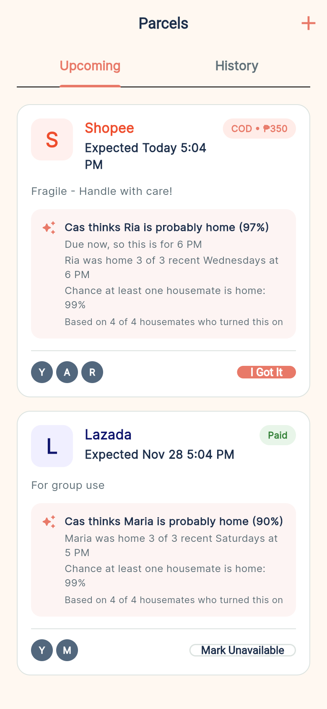
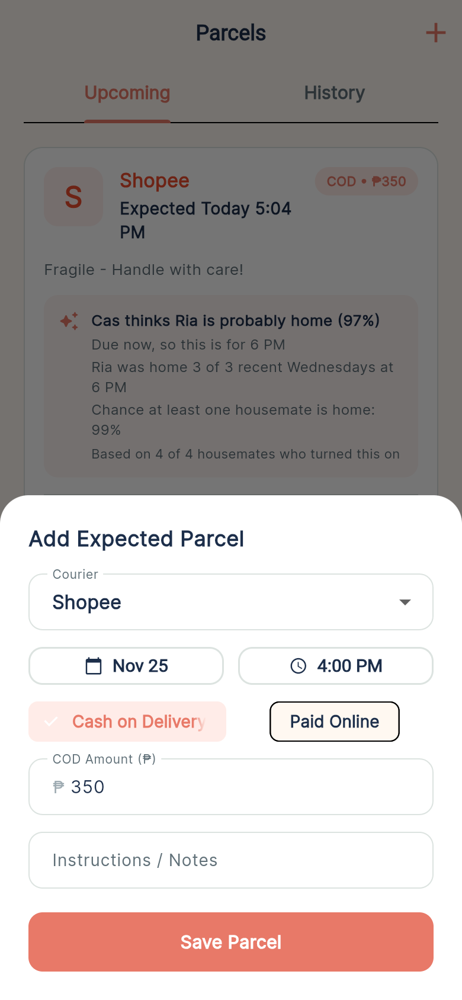

# Casama Home Forecast

AI final project of group Theoraux. A small forecasting algorithm that learns when each housemate is usually home, built into the Casama parcel board so the buyer can see, before the courier comes, who is probably home and which window is the safest.



| | |
|---|---|
| Course | AI final project |
| Group | Theoraux |
| Video | the file `video/theoraux-ai-home-forecast.mp4` in this repository (the Google Drive link is added after upload) |
| Where the code lives | this folder, the Dart module `lib/features/parcels/home_forecast/`, and the small changes listed under Integration |

## The problem

Casama's parcel board asks every housemate to tap "available" for each parcel, and the conflict alert appears only after everyone has tapped unavailable. Nothing tells the buyer, ahead of time, whether anybody is likely to be home. The question this project answers: **given what each housemate's own Home and Out history looks like, who is likely to be home when a parcel is expected, and which window is the safest?**

## What it does

* Learns each opted in housemate's weekly routine from the Home and Out taps the app already records.
* On every upcoming parcel that is due within three days it shows who is probably home, the chance that at least one housemate is home, and a best two hour window when another window is clearly better. Parcels that are overdue, or more than 72 hours away (nothing that far out was tested), get no forecast.
* It is advice only. It never changes who is marked available or the expected arrival.
* It is off for new accounts until a member switches on "Let Cas learn my routine" in Settings. Turning it off deletes what Cas learned. The demo household starts switched on.

## The data and its limits

Training and evaluation use the CASAS smart home dataset (Cook et al., Washington State University), licence CC BY 4.0: https://zenodo.org/records/17180309. It records real homes with motion and door sensors and has activity labels, including `Leave_Home` and `Enter_Home`. We turn those two labels into hourly home or away. An hour counts as home when the labels say someone was home for 30 minutes or more of it.

3 of the 5 homes have both labels and are used: Aruba (219 days, home in 86 percent of hours), Tulum 1 (120 days, 68 percent) and Tulum 2 (183 days, 85 percent). Cairo and Milan only have `Leave_Home`, so the time of return is unknown and they are left out. Before any model was fitted we wrote down a data gate: at least 2 homes with at least 42 usable days each. It passed with 3 homes.

Limits that matter:

* **Three homes is few.** Each fold of the evaluation trains on 2 homes, so every number below is fragile.
* **Tulum 1 and Tulum 2 are two periods of the same CASAS testbed** and may be one household. When one is held out the other is in training, so read the evaluation as closer to two homes than three. The fitted numbers swing between folds (b1 from 1.21 to 8.34), another sign that three homes is too few.
* **These are not Filipino households**, and nobody tested the forecast on housemates sharing a flat.
* **A label marks a household leaving or coming back, not a person.** Aruba is reported to have one resident and the Tulum homes two, according to a dataset listing (the Zenodo record does not say).
* The demo household in the app uses hours taken from these homes as **demo filler**. They are not real housemates.

## How the algorithm works

A **slot** is an hour of the week, 168 in all, Monday 00:00 is slot 0. For one person the forecast has two steps.

1. **Habit.** For each slot, take the past hours in that slot and average whether the person was home, giving recent weeks more weight. An observation that is `a` days old counts `0.5 ^ (a / H)`, where H is the half life, 14.0 days after fitting. The average is smoothed toward a starting value of 0.5 with the weight of 1.0 observation.
2. **Combine.** A logistic regression with three coefficients turns the habit and what the person is doing now into a probability:

```
forecast = sigmoid( b0 + b1 * logit(habit of the target slot) + b2 * (2n - 1) * exp(-h / tau) )
```

`n` is 1 when the person is home now and 0 when out, `h` is the hours until the target hour, and `tau` is 12.0 hours, how long "staying as you are" lasts. The fitted values are b0 = 0.27, b1 = 1.29 and b2 = 1.36. The weekly habit carries most of the weight (b1), and the current state fades with distance (b2).

For a parcel the app forecasts every opted in housemate at the expected hour. The chance that at least one is home is `1 - product(1 - p)`, which assumes housemates are independent, and the best window is the best two hour stretch that day. The housemate ranking and the window are built on the forecast but **are not evaluated separately**.

The Python reference is `src/home_forecast.py`. The Dart port in the app reproduces its numbers to 1e-9 on a golden file of 12 cases, in the test `test/ai/home_forecast_parity_test.dart`.

## How well it works

Walk forward and leave one home out, from 1 to 72 hours ahead (the app shows nothing further out). Each forecast uses only earlier hours, and the held out home never influenced its own coefficients. One choice was made by looking at held out forecasts: starting everyone from a flat 50 percent instead of the other homes' average (question 3 below), so the headline numbers are slightly optimistic. Results are pooled over the folds. Lower Brier score is better, higher AUC is better.

| Hours ahead | Model Brier | Plain hour of week average | Same as right now | Base rate | Model AUC | Plain average AUC | Same as right now AUC |
|---|---|---|---|---|---|---|---|
| 1 | 0.096 | 0.120 | 0.102 | 0.149 | 0.882 | 0.787 | 0.760 |
| 3 | 0.111 | 0.120 | 0.133 | 0.149 | 0.831 | 0.787 | 0.659 |
| 6 | 0.116 | 0.120 | 0.148 | 0.149 | 0.780 | 0.787 | 0.535 |
| 12 | 0.115 | 0.120 | 0.157 | 0.149 | 0.756 | 0.786 | 0.330 |
| 24 | 0.113 | 0.120 | 0.129 | 0.149 | 0.768 | 0.786 | 0.646 |
| 48 | 0.114 | 0.119 | 0.135 | 0.149 | 0.763 | 0.787 | 0.580 |
| 72 | 0.113 | 0.116 | 0.139 | 0.149 | 0.768 | 0.790 | 0.554 |

The base rate is a constant forecast, so it has no ranking skill and its AUC is 0.5 by definition. The four questions we asked before looking, and the answers the numbers give:

1. **Does a per person habit profile forecast better than the simple baselines?** The model has the lowest Brier score of the three simple forecasts at 7 of 7 horizons and the highest AUC at 2 of 7. At 3 hours ahead: model 0.111 (AUC 0.831), plain hour of week average 0.120 (AUC 0.787), same as right now 0.133 (AUC 0.659), base rate 0.149. The honest reading: the model has the lower error score at every horizon, but from 6 hours ahead the plain hour of week average ranks hours slightly better (a higher AUC).
2. **How many days of history does it need?** AUC at 3 hours ahead when the forecast sees only the last N days of history: 3 days 0.660, 7 days 0.792, 14 days 0.826, 28 days 0.835. A slot only repeats once a week, so with 3 days of history the habit has nothing to learn from. About two weeks of taps gets most of the benefit.
3. **Does the population prior help a brand new member in their first week?** In a new home's first 7 days the population prior hurts: Brier 0.217 with it, 0.168 with a flat 0.5 prior. The model therefore starts every member from a flat 50 percent.
4. **How much does a heavier model improve on the small one?** The gradient boosted yardstick scores Brier 0.117 (AUC 0.825) at 3 hours ahead against 0.111 (AUC 0.831) for the small model. We kept the small model because it is explainable, runs on the phone and is not worse.

**Calibration.** When the model says 90 to 100 percent, the person was home 93 percent of the time (52401 forecasts), a little less than it said. Below 80 percent it errs the other way: the person was home more often than it said. For example, forecasts of about 35 percent were home 46 percent of the time, and forecasts under 10 percent were home 11 percent of the time. That is why the app says "probably" and "might", and never shows 0 or 100 percent.

## Integration in the Casama app

The module is pure Dart in `lib/features/parcels/home_forecast/` and learns on the device. The data flow:

1. A member who opted in taps Home or Out (the app already had this). `MockRepository.updatePresence` now also records a tap for that member.
2. On a parcel card, `ForecastRow` asks `MockRepository.forecastInputs` for each opted in member's hours and calls `adviseArrival`, which uses `forecastHome` and the parameters fitted in Python (`forecast_params_data.dart`, generated from `output/home_forecast.json`).
3. The card shows the result. Nothing is written back to the parcel.

Changes to files of the 3rd year team, all additive and small:

* `lib/data/mock_repository.dart`: opt in switch, tap history, the demo seed, and `forecastInputs`.
* `lib/features/parcels/parcels_screen.dart`: the forecast row on upcoming parcels and a short window hint in the add parcel sheet.
* `lib/features/settings/app_settings_screen.dart`: the switch "Let Cas learn my routine".
* `lib/features/legal/terms_privacy_screen.dart`: the card "Optional Routine Forecast".
* `test/widget_test.dart`: one expectation changed from 5 to 6 switches in the settings screen.
* `pubspec.lock`: changed by `flutter pub get` on a newer Flutter, restore it with `git checkout -- pubspec.lock`.



## Privacy by design

Casama promises that presence is manual and never tracked. The forecast keeps that promise:

* It is **off for new accounts** and can be switched off at any time, which deletes that member's history.
* It learns **only from the Home and Out taps** the app already records. No location, no new permission.
* It runs **on the device** and is shown only to housemates, as a probability for one hour with a short reason, never as a full away schedule. The reason line does reveal one hour of someone's usual week, for example "home 3 of 12 recent Thursdays at 2 PM", which is why the feature is opt in.
* A member who has not opted in is never forecast, never recorded and never counted in anyone's window.
* In the **demo household** the four demo housemates are pre opted in, because the demo has one signed in user and the others cannot tap. This is stated on the privacy card in the app.

A routine forecast is sensitive. Used badly it tells someone when a home is empty. That is why it stays inside the household and why it is opt in.

## What it cannot do

* It cannot tell who is home right now, only how likely it is.
* The "at least one housemate is home" number assumes housemates are independent. Housemates who share a timetable are not.
* The in app history lives in memory like the rest of the mock repository and resets when the app restarts. The Supabase schema already has a `presence_events` table where a real backend would keep it.
* It does not forecast parcels more than 72 hours away, because nothing beyond that was tested, and a parcel that was due in an hour that has already passed gets no forecast.
* Nobody has tested it with real Filipino housemates.

## Run it

```
cd AI
pip install -r requirements.txt
python src/run_all.py      # download CASAS, data gate, evaluation, parameters, golden file, Dart constants
python -m pytest           # the Python tests
python src/build_readme.py # rebuild this README from output/metrics.json
cd ..
flutter test               # all app tests, including test/ai
flutter run -d chrome      # the app, open Parcels
```

## Video

An 8 to 10 minute narrated video is in `video/` (script, narration timings, sound effects and the HyperFrames project). The link is in the table at the top once it is uploaded. The voice is synthetic: Kokoro, an open source speech model, run on the computer so nothing is sent anywhere (its licence and the package that runs it are in `REFERENCES.md`).

## Credits

Group Theoraux: Theodore Von Joshua M. Bunquin, Christian B. Nayre, Daniel B. Villanueva, John C. Alcaraz and Paul C. Alcaraz.

Data: CASAS smart home dataset, Diane Cook and colleagues, Washington State University, CC BY 4.0. Full references and licence notes: `REFERENCES.md`.
